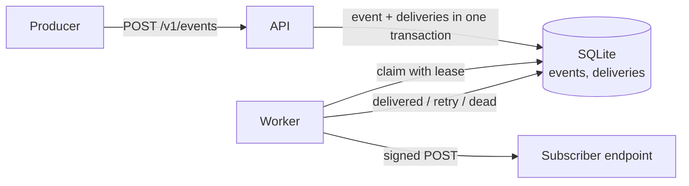

# webhook-relay

Durable webhook delivery as a small service. Producers publish events to an HTTP API; a worker delivers each event to every matching subscriber, signed with HMAC, retried with exponential backoff and jitter, and parked in a dead-letter state when it cannot be delivered. Built with FastAPI and the Python standard library, backed by SQLite.

## How it works



- **Transactional outbox.** An event and its per-subscriber deliveries are written in a single transaction, so an accepted event cannot be lost between "stored" and "queued".
- **Leases.** Workers claim due deliveries atomically and hold a lease. If a worker crashes, the lease expires and the delivery is claimed again. The attempt counter increments when a delivery is claimed, so a crash-looping delivery still ends up dead.
- **At-least-once delivery.** A subscriber can receive the same event more than once (for example when its response times out after processing). Receivers should deduplicate on the event id. Ordering is not guaranteed.
- **Idempotent publishing.** Send an `Idempotency-Key` header; replaying the same key returns the original event (`200`) and creates no new deliveries.

## Delivery rules

| Response | Outcome |
|---|---|
| `2xx` | delivered |
| network error, timeout, `408`, `425`, `429`, `5xx` | retried with backoff |
| any other `3xx` or `4xx` | dead immediately (redirects are never followed) |
| target fails the URL policy | dead immediately |

Retry delay is a uniform random value between 0 and `min(max_delay, base_delay * 2^(attempt-1))` (full jitter). With the defaults (`base_delay` 2 s, `max_delay` 300 s, 6 attempts) the longest possible waits are 2, 4, 8, 16 and 32 seconds, then the delivery is dead. That suits a demo. For production-style retries over hours, set for example `RELAY_BASE_DELAY=30`, `RELAY_MAX_ATTEMPTS=10`, `RELAY_MAX_DELAY=3600`.

Dead deliveries can be re-queued with `POST /v1/deliveries/{id}/retry`.

## Security

- API key on every endpoint except `/healthz` (constant-time comparison). The app refuses to start without a key of at least 16 characters.
- Each request carries `X-Relay-Signature: t=<unix time>,v1=<hmac-sha256>`, computed over `"<t>.<raw body>"` with the subscription secret. Receivers should check the signature and reject timestamps older than a few minutes.
- Outbound URL policy against SSRF: only `http` and `https`, no credentials in the URL, and the host must resolve to public addresses only (loopback, private, link-local and similar ranges are refused). The check runs when a subscription is created and again before every send.
- Subscription secrets are shown once, at creation. Event data is capped at 256 KB by default. The container runs as a non-root user and published ports bind to `127.0.0.1` by default.

## Quick start

```bash
cp .env.example .env            # set RELAY_API_KEY (openssl rand -hex 24)
docker compose up -d --build
```

```bash
KEY=<your RELAY_API_KEY>

# 1. register a subscriber (the response contains its secret, shown once)
curl -s -X POST localhost:8000/v1/subscriptions -H "X-API-Key: $KEY" \
  -H "Content-Type: application/json" \
  -d '{"url": "https://example.com/hook", "event_types": ["order.*"]}'

# 2. publish an event
curl -s -X POST localhost:8000/v1/events -H "X-API-Key: $KEY" \
  -H "Content-Type: application/json" -H "Idempotency-Key: order-42-created" \
  -d '{"type": "order.created", "data": {"order_id": 42}}'

# 3. inspect deliveries, stats and metrics
curl -s "localhost:8000/v1/deliveries?status=dead" -H "X-API-Key: $KEY"
curl -s localhost:8000/v1/stats -H "X-API-Key: $KEY"
```

To try it against a local receiver, set `RELAY_ALLOW_PRIVATE_TARGETS=1`, run `RELAY_SECRET=<secret> python examples/receiver.py`, and subscribe `http://127.0.0.1:9000/hook`. From inside Docker, the receiver must be reachable from the worker container.

### API

| Method and path | Purpose |
|---|---|
| `POST /v1/subscriptions` | register a subscriber (`url`, optional `event_types`, optional `secret`) |
| `GET /v1/subscriptions` | list subscribers (secrets are not returned) |
| `DELETE /v1/subscriptions/{id}` | deactivate a subscriber |
| `POST /v1/events` | publish an event (`202`, or `200` on an idempotent replay) |
| `GET /v1/deliveries`, `GET /v1/deliveries/{id}` | inspect deliveries (filter by `status`, `event_id`) |
| `POST /v1/deliveries/{id}/retry` | re-queue a dead delivery |
| `GET /v1/stats`, `GET /metrics` | counts by status (JSON, Prometheus text) |
| `GET /healthz` | liveness (no auth) |

Event types match exactly, by prefix (`order.*`), or with `*`.

### Verifying a signature (receiver side)

```python
from webhook_relay.signing import verify_signature, SignatureError

try:
    verify_signature(SECRET, request.headers["X-Relay-Signature"], raw_body, tolerance=300)
except SignatureError:
    ...  # reject with 401
```

The scheme is simple enough to reimplement in any language: HMAC-SHA256 over `"<t>.<raw body>"`, hex-encoded, compared in constant time.

## Development

```bash
python -m venv .venv && source .venv/bin/activate     # Windows: .venv\Scripts\activate
pip install -e ".[dev]"
pytest -q
ruff check .
```

The suite covers signing, backoff, the URL policy, the store (including concurrent claims from several threads), the worker (retry timing, exhaustion, lease expiry), end-to-end delivery against a real local HTTP server, and the API. The core tests need only the standard library; the API tests need `fastapi` and `httpx` and are skipped without them.

## Design decisions and limits

- **SQLite in WAL mode.** Zero setup, and enough for one host. The API and worker are separate processes sharing one database file, so this does not scale across machines.
- **Polling worker.** A claim query every `poll_interval` seconds. Simple and robust; adds up to that much latency.
- **Plaintext secrets in the database.** HMAC signing needs the raw secret. A production deployment should encrypt them at rest or fetch them from a secrets manager.
- **DNS rebinding.** The URL policy resolves the host, then the HTTP client resolves it again, so the check can in principle be raced.
- **No per-subscriber rate limiting, circuit breaker or `Retry-After` handling.** One slow subscriber can occupy worker threads until its timeout.

## Roadmap

- PostgreSQL with `FOR UPDATE SKIP LOCKED` for multi-node workers
- Pin the validated IP address when connecting
- Per-subscriber circuit breaker and `Retry-After` support
- Secret rotation and encryption at rest
- Latency histograms in `/metrics`
